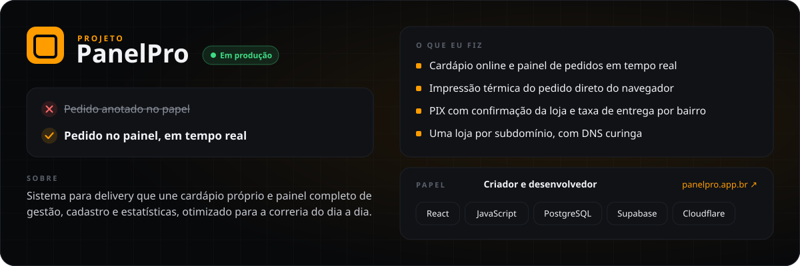
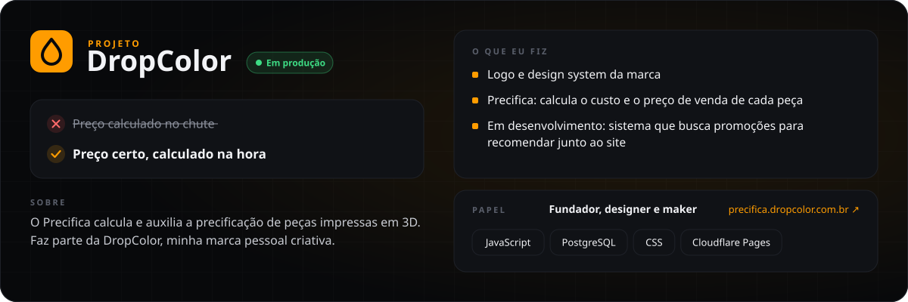
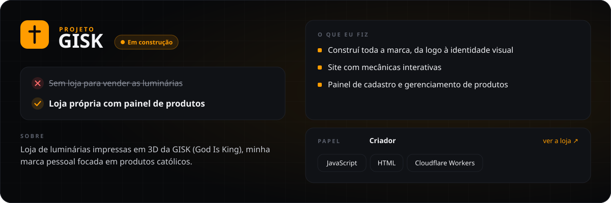
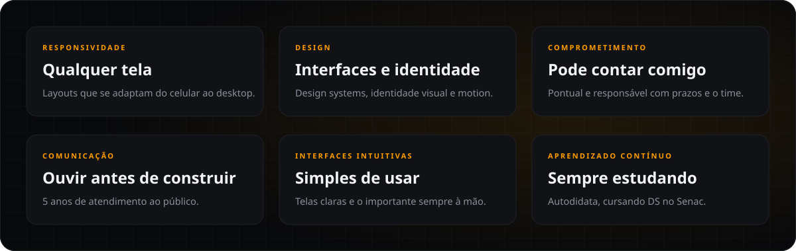
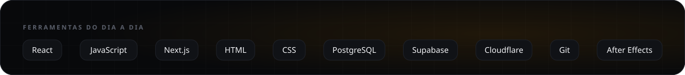
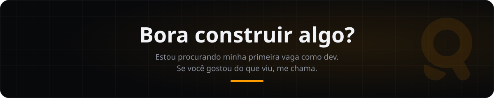

  

&nbsp;
&nbsp;

  

Meus projetos nasceram de **problemas reais do meu dia a dia** e viraram marcas e produtos. 
Uno código, design e cinco anos de atendimento ao público para construir telas simples de usar.

 

## Projetos

 

## O que eu trago para o time

 

## Formação

| Quando | Onde eu aprendi |
| :--- | :--- |
| **2027** · cursando | **Técnico em Desenvolvimento de Sistemas** — Senac São Carlos |
| **2025** · 60h | **Ninja do Delivery — Programação Web** — sistema completo de gestão de delivery |
| **2022** · 25h | **Designer de Qualidade** — fundamentos de design gráfico e identidade visual |
| **2016** · 40h | **Manutenção de Computadores** — PROUNIP |

 

 

**[→ Ver o portfólio completo](https://quiet-voice-0a7e.rafsplayofc.workers.dev/)**

